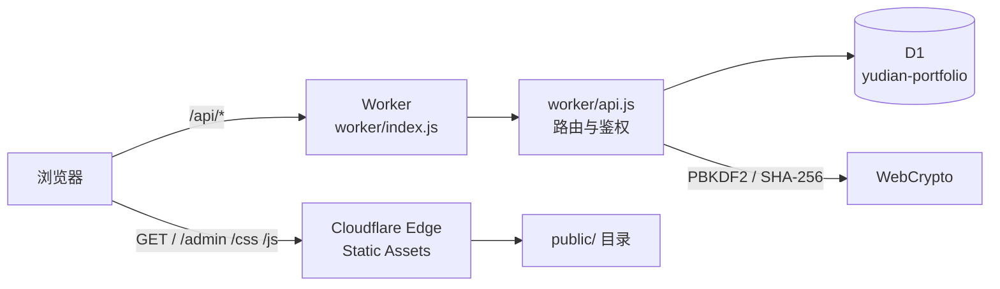

# 于典个人网站 · 技术设计（TECH_DESIGN）

| 项目 | 内容 |
| --- | --- |
| 版本 | v1.2 |
| 更新时间 | 2026-10-21 |
| 运行环境 | Cloudflare Workers + D1 + Static Assets |
| 相关文档 | `PRD.md`（需求）、`AGENTS.md`（协作约定） |

---

## 1. 架构总览

单 Worker + 静态资源 + 一个 D1 数据库。浏览器直接拿静态页面，只有 `/api/*` 会执行 Worker 脚本。



请求顺序：

1. 命中 `public/` 中真实文件 → 直接由边缘返回，不执行 Worker，**不计入 Worker 请求额度**。
2. `/api/*` → 先 `ensureDatabase(env)`，再交给 `handleApi`，响应套统一安全头。
3. `/admin` → 返回 `public/admin.html`；`/` → `public/index.html`。
4. 其余路径 → 走 `ASSETS` 绑定，未命中时返回 `public/404.html`（状态码保持 404）。

---

## 2. 技术选型与理由

| 选择 | 理由 | 放弃的方案 |
| --- | --- | --- |
| Cloudflare Workers | 免费额度足够、无服务器运维、全球边缘 | 自建 VPS（需运维与费用） |
| D1（SQLite） | 免费 5 GB、SQL 熟悉、与本地 SQLite 语法一致 | KV（无查询能力）、Postgres（需付费实例） |
| 静态资源绑定 | 静态请求免费且不限量 | Pages（多一套部署链路） |
| 原生 HTML/CSS/JS | 无构建步骤、体积小、长期可维护 | React/Vue（增加体积与构建复杂度） |
| WebCrypto | 无需 `nodejs_compat`，冷启动快 | Node 兼容层 + `crypto.scrypt`（更重） |
| 图片地址而非上传 | 不引入 R2 订阅，保持 0 成本 | R2 / Images / KV 存图 |

已明确移除：R2 绑定、`/api/upload`、`/uploads/*` 路由、后台三处上传控件。

---

## 3. 目录与模块职责

```text
wrangler.toml          # Worker 名称、静态资源目录、D1 绑定、vars
worker/index.js        # 入口：分流、静态资源、安全响应头、404
worker/api.js          # REST 路由、参数校验、鉴权、限流、导出
worker/auth.js         # PBKDF2 哈希、会话 token、SHA-256、限流原语
worker/db.js           # 首次初始化：建表 + 种子 + 管理员
worker/schema.js       # DDL（幂等）
worker/seed.js         # 示例内容
public/                # 前台、后台、CSS、JS、资源、_headers
server.js / lib/       # 旧 Node 实现，保留但不再使用
```

前端模块：

- `public/js/main.js`：拉取 `/api/site`、渲染首页、Hash 路由、联系表单。
- `public/js/admin.js`：登录、各面板渲染、表单提交、图片地址预览。
- `public/js/markdown.js`：先转义再解析的 Markdown 子集渲染器。
- `public/js/starfield.js`：Canvas 星空。

---

## 4. 数据模型（D1）

所有表在 `worker/schema.js` 中以 `CREATE TABLE IF NOT EXISTS` 定义，可重复执行。

- `admin`：单行（`id = 1`），`username`、`password_hash`、`created_at`。
- `sessions`：`token_hash` 主键、`expires_at`（毫秒时间戳）、`created_at`；索引 `expires_at`。
- `profile`：单行（`id = 1`），姓名 / 身份 / 简介 / 头像 / 简历 / 状态 / `socials`(JSON 字符串)。
- `skills`：`category`、`name`、`level`、`sort`。
- `projects`：`title`、`summary`、`description`、`tech`(JSON)、`cover_url`、`demo_url`、`repo_url`、`year`、`featured`、`sort`、`created_at`。
- `posts`：`title`、`slug`（唯一）、`excerpt`、`content`、`tags`(JSON)、`cover_url`、`published`、`created_at`、`updated_at`。
- `messages`：`name`、`email`、`content`、`is_read`、`created_at`。
- `rate_limits`：`key`、`count`、`reset_at`，固定窗口限流。

排序约定：`skills` / `projects` 按 `sort ASC, id ASC`；项目另按 `featured DESC` 优先；文章按 `created_at DESC`。

---

## 5. API 设计

统一返回 JSON；错误体为 `{ error: string }`；写操作要求同源 `Origin`。

### 公开接口

| 方法与路径 | 说明 |
| --- | --- |
| `GET /api/health` | 健康检查，返回 `{ ok, time }` |
| `GET /api/site` | 站点聚合数据：`profile`、`skills`、`projects`、已发布 `posts`、`counts` |
| `GET /api/posts/:slug` | 已发布文章详情，含 `read_minutes` |
| `POST /api/contact` | 提交留言，蜜罐字段 `website` 命中时静默成功 |
| `GET /api/auth/me` | 当前会话状态 |
| `POST /api/auth/login` | 登录，写入 `yd_sid` Cookie |
| `POST /api/auth/logout` | 删除会话并清 Cookie |

### 后台接口（需会话）

| 方法与路径 | 说明 |
| --- | --- |
| `GET /api/admin/state` | 全量后台数据（含草稿、留言最近 200 条） |
| `PUT /api/admin/profile` | 更新个人信息与社交链接 |
| `PUT /api/admin/password` | 校验当前密码后改密，并注销其他会话 |
| `GET /api/admin/export` | 导出 JSON 备份（附件下载） |
| `POST /api/admin/skills`、`PUT/DELETE /api/admin/skills/:id`、`POST /api/admin/skills/:id/move` | 技能增删改与排序 |
| `POST /api/admin/projects`、`PUT/DELETE /api/admin/projects/:id`、`POST /api/admin/projects/:id/move` | 项目增删改与排序 |
| `POST /api/admin/posts`、`PUT/DELETE /api/admin/posts/:id` | 文章增删改（slug 冲突自动加后缀） |
| `PUT/DELETE /api/admin/messages/:id` | 标记已读 / 删除留言 |

### 输入校验

- 通用文本裁剪 + 长度上限（如一句话 200、留言 2,000、正文 200,000）。
- 链接只允许 `http(s)://`、`mailto:`、`/` 开头。
- JSON 请求体上限 2 MB；标签去重、限长。
- 留言邮箱做基础格式校验，非法时保存为空。

---

## 6. 认证、会话与限流

- 密码：`PBKDF2-SHA256`，25,000 轮，16 字节随机盐，32 字节派生密钥；存储格式 `pbkdf2$<轮数>$<盐b64>$<哈希b64>`，验证时读取存储中的轮数，因此调整轮数不会让旧密码失效。
- 会话：32 字节随机 token → 只把 `SHA-256(token)` 存入 `sessions`；有效期 7 天；Cookie `yd_sid`，`HttpOnly`、`SameSite=Lax`，HTTPS 下加 `Secure`。
- 限流（存在 D1，跨 isolate 生效，固定窗口）：
  - 登录：`login:<ip>`，10 分钟 8 次。
  - 留言：`contact:<ip>`，10 分钟 5 次。
  - 每 25 次写入顺带清理过期窗口。
- 修改密码会删除该管理员的全部会话；登出删除当前 token 对应行。

轮数的取舍：100,000 轮在免费计划 10 ms CPU 预算下容易触发 Error 1102，因此降到 25,000，并依赖 8 次/10 分钟的登录限流抵御暴力破解。

---

## 7. 安全设计

- 全站响应头：CSP（`default-src 'self'`，图片允许 `https:`、`data:`）、HSTS、`nosniff`、`DENY` 嵌入、`Referrer-Policy`、`Permissions-Policy`。
- 静态资源头放在 `public/_headers`；Worker 响应由 `secure()` 统一补齐。
- 写接口校验 `Origin` 与请求 Host 一致，防 CSRF。
- Markdown 渲染先做 HTML 转义，只放行安全协议链接，禁止内联脚本。
- 404 保持 404 状态码；错误响应不泄露堆栈。
- 密码、会话 token 均不以明文落库。

---

## 8. 初始化与启动流程

`ensureDatabase` 每个 isolate 最多执行一次（`ready` / `booting` 双标志避免并发重复执行）：

1. 批量执行 `SCHEMA` 中所有 DDL（幂等）。
2. `SELECT COUNT(*) FROM skills` 为 0 时写入种子内容（`worker/seed.js`）。
3. `admin` 表为空时，用 `ADMIN_USERNAME` / `ADMIN_PASSWORD` 创建管理员；未配置密码时使用示例值并在日志中提示。

任何 `/api/*` 请求都会触发该流程；静态资源请求不会。

---

## 9. 配置、部署与运维

`wrangler.toml` 关键项：

- `name = "test"`：必须与 Cloudflare 上的 Worker / Workers Builds 项目名一致，否则 CI 会覆盖并告警。
- `[assets]`：`directory = "./public"`，`binding = "ASSETS"`，`not_found_handling = "404-page"`。
- `[[d1_databases]]`：`binding = "DB"`，`database_name = "yudian-portfolio"`，真实 `database_id`。
- `[vars]`：`ADMIN_USERNAME = "admin"`。
- `ADMIN_PASSWORD` 走 secret，不写进仓库。

首次部署顺序：`wrangler login` → `d1 create` → 写入 `database_id` → `secret put ADMIN_PASSWORD` → `deploy`。密码 secret 必须在站点第一次被访问前设置，否则默认密码会写进 D1。

日常：`git push` 触发 Workers Builds（构建命令 `npx wrangler deploy`）；也可本地 `npx wrangler deploy`。日志用 `npx wrangler tail`。

备份：后台「下载数据备份」导出 JSON；D1 免费版有 7 天 Time Travel。

---

## 10. 本地开发

```bash
npm install
npx wrangler dev        # http://127.0.0.1:8787
```

- 本地 D1 / 资源状态在 `.wrangler/state/`，删除即重置。
- 本地可用 `.dev.vars` 覆盖 `ADMIN_USERNAME` / `ADMIN_PASSWORD`（已被 git 忽略）。
- **同一目录只能运行一个 `wrangler dev`**：第二个实例会争抢端口与 `.wrangler/tmp` 打包目录，导致 `workerd` 崩溃或 `Could not resolve ... middleware-loader.entry.ts`。
- 修改 `wrangler.toml`（绑定、名称）后需要重启进程，热重载只覆盖代码与静态资源。

---

## 11. 测试与验收

- 接口冒烟脚本（本地、不入库版本库）：覆盖站点数据、留言与蜜罐、登录/登出/改密、技能/项目/文章的增删改与排序、草稿可见性、slug 去重、留言收件箱、导出、静态资源与 404、CSP/HSTS、越权访问。当前 50 项全部通过。
- 构建校验：`npx wrangler deploy --dry-run`；远端绑定校验可用 `npx wrangler versions upload`（不上流量）。
- 手工验收：`/admin` 登录后确认各面板可保存、封面只接受地址、移动端布局正常。

---

## 12. 性能与成本

- 工作集：Worker 包约 55 KB（gzip 约 15 KB），启动时间约 4 ms。
- 静态资源 21 个文件，命中后不执行脚本，免费且不限量。
- 免费额度：Worker 10 万请求/天、单请求 10 ms CPU；D1 500 万行读/天、10 万行写/天、5 GB；Workers Builds 3000 分钟/月。
- 一次 `GET /api/site` 约读取 20 行；后台写操作每次 1~3 行。

---

## 13. 已知限制与演进方向

- 只有单管理员、单 profile；没有找回密码流程（需重置 D1 中 `admin` 行）。
- 留言只在读取时限制 200 条，不做自动清理。
- 无站内搜索、分页、RSS、sitemap。
- 图片依赖外链或仓库内文件，没有上传与压缩能力。
- 首次初始化在建表 + 种子 + 密钥派生叠加时接近 10 ms CPU 上限；若线上出现 500，可把 DDL/种子改为部署期执行。
- 旧 Node 实现（`server.js`、`lib/`、`data/`、`uploads/`）仍在仓库中，可择机移除。
